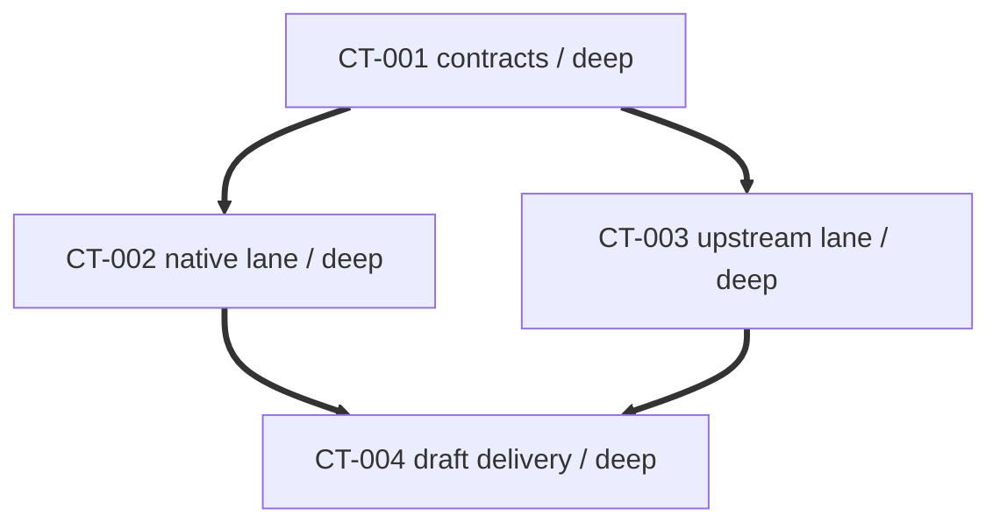

# Cloud sidecar spike

Approved scope: local synthetic providers, isolated TypeScript dependency universes, private draft PR only. Python science and runtime stay untouched. Approved Library plan v1 was read through Library; both supported materialization attempts failed to download. No paid jobs, credentials, deployment, upstream communication, or merge.

## CT-001 — Shared contracts and independent provider

Own engine-neutral data, pure admission/claim/cancellation/accounting transitions, and a separately persisted provider/observer fixture. Consumers share source contracts without sharing Effect dependencies.

```yaml
id: CT-001
depth: deep
depends_on: []
footprint:
  creates:
    - cloud-controller/shared/*
produces:
  - cloud-controller/shared/contracts.ts::RunSpec
  - cloud-controller/shared/domain.ts::transition
  - cloud-controller/shared/provider-worker.ts::FakeProvider
gate: "Shared domain behavioral tests pass; provider fixture persists independently of either workflow runtime."
```

## CT-002 — Native Cloudflare lane

Implement effect-cf/native Workflow with SQLite ledger, official SQL adapter diagnostic, deterministic claims, outbox, cancellation and immutable receipts. Test actual workerd restart without polling the target.

```yaml
id: CT-002
depth: deep
depends_on: [CT-001]
footprint:
  creates:
    - cloud-controller/lane-a/*
produces:
  - cloud-controller/lane-a/EVIDENCE.md::runtime-results
gate: "Locked type/unit/runtime tests execute and each required failure gate is recorded truthfully as passed, failed or not run."
```

## CT-003 — Upstream Cloudflare lane

Build PR 7322 coherently with pnpm 11.20.0 lockfile and patches. Use the existing upstream engine and harness, add independent durable-observer first-activity/child-wake regressions, completed and suspended controls, and evaluate shared provider boundaries. A failing recovery regression is valid evidence.

```yaml
id: CT-003
depth: deep
depends_on: [CT-001]
footprint:
  creates:
    - cloud-controller/lane-b/*
produces:
  - cloud-controller/lane-b/EVIDENCE.md::runtime-results
gate: "Exact upstream source and coherent dependencies recorded; actual workerd regressions and controls executed or concrete blockers recorded. No new durability engine."
```

## CT-004 — Review and private draft delivery

Integrate both lanes, tighten and review correctness/security, run Python checks, record comparison and unresolved integration prerequisites, verify privacy before pushing, verify remote commit and CI, open a private draft PR. No merge.

```yaml
id: CT-004
depth: deep
depends_on: [CT-002, CT-003]
footprint:
  creates:
    - cloud-controller/README.md
    - cloud-controller/DECISION.md
    - .github/workflows/cloud-sidecar.yml
gate: "Private draft PR and remote commit verified; CI results and remaining blockers reported without overstating runtime evidence."
```

## Graph


